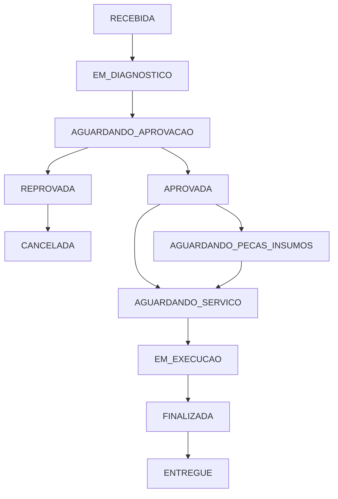
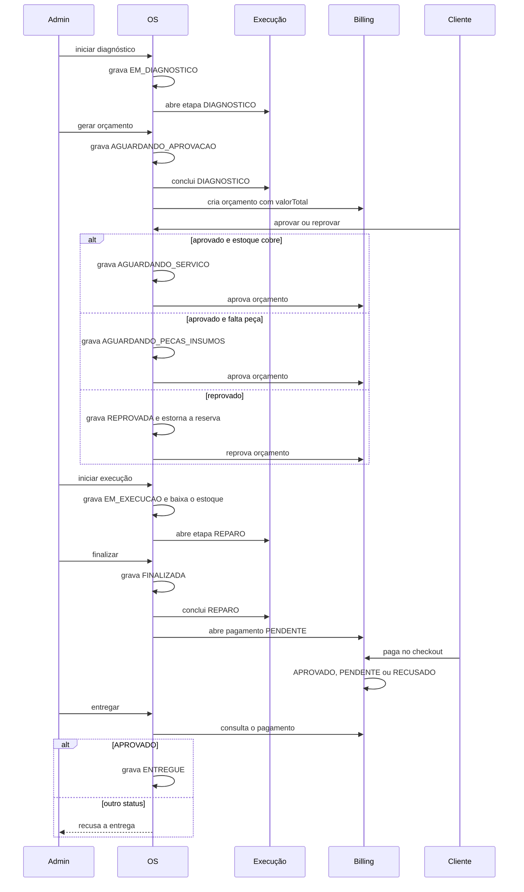

# Fluxo da ordem de serviço

Três serviços participam. A OS é a dona do status e conduz a sequência. A execução só registra se o diagnóstico ou o reparo está aberto ou concluído. O billing guarda o orçamento e o pagamento, com o `valorTotal` já calculado pela OS. Nenhum serviço lê o banco do outro.

O pagamento acontece na retirada, depois de `FINALIZADA` e antes de `ENTREGUE`. A página de checkout fica no billing. Pagamento aprovado esconde o formulário. Pagamento pendente, já enviado ao Mercado Pago, avisa que aguarda o retorno. Pagamento recusado pede nova tentativa e mantém o formulário. A entrega consulta o billing e só segue se o status local estiver `APROVADO`.

## Status

`AGUARDANDO_PECAS_INSUMOS` aparece quando, na aprovação, a quantidade física não cobre o que já foi reservado. A reposição de estoque tenta liberar essas ordens para `AGUARDANDO_SERVICO`. `CANCELADA` só sai de `REPROVADA`.

## Quem é chamado

A porta pública é o API Gateway, e ela não lista cada rota. `POST /auth/cpf` vai para a Lambda, que consulta o cliente na OS por HTTP. O proxy geral leva o restante da OS: login de administrador, cadastro e ordem. No billing, só o checkout e a cobrança atravessam o gateway, sem escolher perfil: o dono do veículo e o administrador usam os dois. Orçamento, execução e a abertura do pagamento ficam fora dessa borda. A OS chama esses serviços direto.

A gravação do status acontece antes da chamada remota. Se o outro serviço falhar, o status local permanece e a mesma etapa pode ser tentada de novo: abrir diagnóstico, orçamento e pagamento é idempotente. Estorno no Mercado Pago não faz parte deste fluxo. A decisão de consultar o pagamento, em vez de receber webhook, está na [ADR 002](./adr/002-consulta-ativa-do-pagamento.md). A divisão dos serviços está na [ADR 001](./adr/001-divisao-dos-servicos-e-banco-por-aplicacao.md). O que entra no gateway, e por que o corpo não é cifrado de novo, está na [ADR 003](./adr/003-borda-publica-do-gateway.md).
