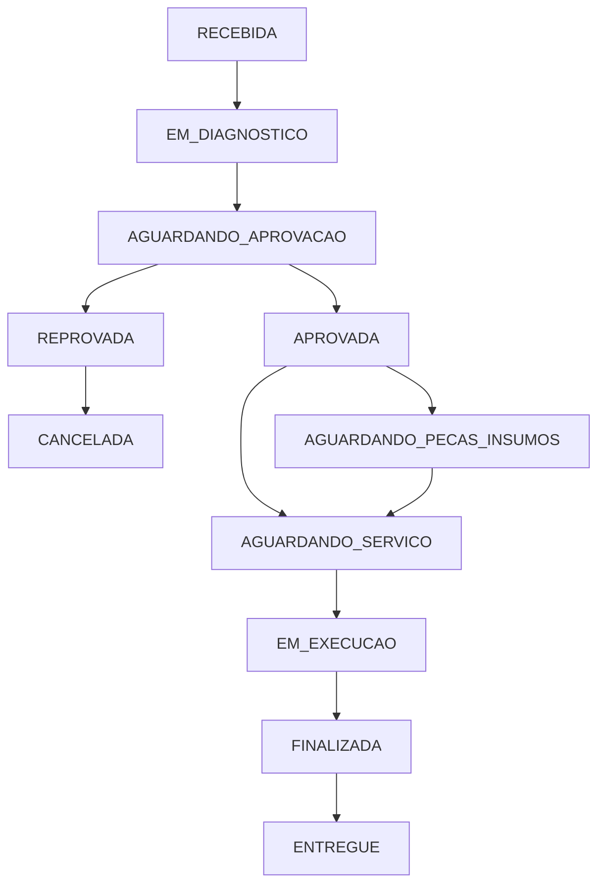
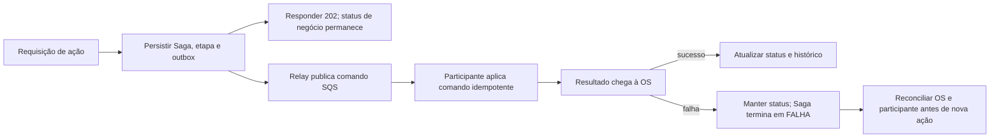
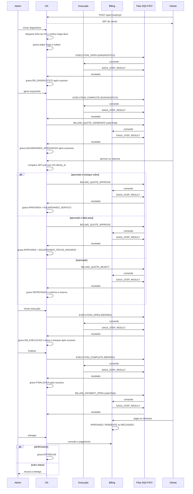

# Fluxo da ordem de serviço

Três serviços participam. A OS é a dona do status e conduz a sequência. A execução só registra se o diagnóstico ou o reparo está aberto ou concluído. O billing guarda o orçamento e o pagamento, com o `valorTotal` já calculado pela OS. Nenhum serviço lê o banco do outro.

O pagamento acontece na retirada, depois de `FINALIZADA` e antes de `ENTREGUE`. A página de checkout fica no billing. Pagamento aprovado esconde o formulário. Pagamento pendente, já enviado ao Mercado Pago, avisa que aguarda o retorno. Pagamento recusado pede nova tentativa e mantém o formulário. A entrega consulta o billing e só segue se o status local estiver `APROVADO`.

## Status

`AGUARDANDO_PECAS_INSUMOS` aparece quando, na aprovação, a quantidade física não cobre o que já foi reservado. A reposição de estoque tenta liberar essas ordens para `AGUARDANDO_SERVICO`. `CANCELADA` só sai de `REPROVADA`.

O status é eventual em relação às etapas remotas da Saga: a API aceita a ação e persiste a etapa/outbox antes do envio; a ordem permanece com o status anterior enquanto aguarda o resultado. Se a Saga terminar em `FALHA` ou uma mensagem for para DLQ, o status não representa necessariamente o progresso técnico do participante. Reconciliar a etapa e o efeito no serviço dono antes de qualquer redrive; consulte o [guia operacional](./operacao-saga-sqs.md).

Os estados acima são o **status de negócio canônico da OS**. A execução assíncrona de uma mensagem tem um estado técnico separado (`PENDENTE`, `EM_PROCESSAMENTO`, `CONCLUIDA` ou `FALHA`), que não aparece no campo `status` da ordem e não substitui nenhuma transição deste diagrama. Tentativas, último erro e necessidade de intervenção são metadados operacionais, não status de negócio.

## Comandos da Saga orquestrada

A OS é o único orquestrador: recebe a ação do ator, persiste a etapa da Saga e publica um comando por SQS. Billing e Execução aplicam somente o comando recebido e devolvem um resultado correlacionado. A OS valida `sagaId`, `commandId`, `osId`, `causationId` e o estado esperado; em caso de sucesso, grava as alterações locais, histórico e status de negócio na mesma transação, e decide se publica outro comando. Um participante nunca escolhe ou publica o próximo comando.

As rotas que iniciam trabalho remoto mantêm seus caminhos e respondem `202 Accepted` com `osId`, `sagaId`, `commandId` e `status: PENDENTE`. A OS bloqueia a linha da ordem durante a aceitação e rejeita com `409 Conflict` outra ação enquanto houver Saga `PENDENTE` ou `EM_PROCESSAMENTO`; assim, duas requisições concorrentes não criam Sagas dependentes em paralelo. Após uma Saga terminal, a próxima ação ainda precisa ser válida para o status canônico atual. O status canônico da OS permanece no estado anterior até o resultado remoto de sucesso ser processado. Consulte `GET /api/v1/ordens/:id/sagas/:sagaId` para acompanhar status e etapas ordenadas; essa rota exige autenticação e consulta a Saga pelo par `osId`/`sagaId`. Resultados repetidos são confirmados sem repetir efeitos locais. Resultado desconhecido, inválido ou sem correspondência não altera a OS e permanece sem confirmação para seguir a política da DLQ.

O grupo FIFO é o `osId`, e a sequência também é validada no Postgres: a primeira etapa é `1`, cada etapa seguinte deve ser contígua e só pode ser criada após a anterior concluir. Ao receber um resultado, a OS confere que todos os predecessores persistidos estão `CONCLUIDA`; um resultado fora de ordem não altera status, histórico ou efeitos locais e não é confirmado na fila.

| Ação iniciada       | Comandos emitidos pela OS, em ordem                                                  | Quando a OS grava o status de negócio                                                                                                                                                             |
| ------------------- | ------------------------------------------------------------------------------------ | ------------------------------------------------------------------------------------------------------------------------------------------------------------------------------------------------- |
| Iniciar diagnóstico | `EXECUTION_OPEN` (`DIAGNOSTICO`)                                                     | Após resultado de sucesso da Execução: `RECEBIDA` → `EM_DIAGNOSTICO`.                                                                                                                             |
| Gerar orçamento     | `EXECUTION_COMPLETE` (`DIAGNOSTICO`), depois `BILLING_QUOTE_GENERATE` (`valorTotal`) | Só após sucesso dos dois comandos: `EM_DIAGNOSTICO` → `AGUARDANDO_APROVACAO`. Uma falha encerra a Saga como `FALHA` e mantém o status canônico anterior.                                          |
| Aprovar orçamento   | `BILLING_QUOTE_APPROVE`                                                              | Após sucesso do Billing, a OS aplica a disponibilidade de peças e grava `APROVADA` e o destino local (`AGUARDANDO_SERVICO` ou `AGUARDANDO_PECAS_INSUMOS`) na transação da OS.                     |
| Reprovar orçamento  | `BILLING_QUOTE_REJECT`                                                               | Após sucesso do Billing, a OS estorna as reservas e grava `REPROVADA` na transação da OS.                                                                                                         |
| Iniciar execução    | `EXECUTION_OPEN` (`REPARO`)                                                          | Após sucesso da Execução, a OS dá baixa nas peças e grava `EM_EXECUCAO` na mesma transação local.                                                                                                 |
| Finalizar           | `EXECUTION_COMPLETE` (`REPARO`), depois `BILLING_PAYMENT_OPEN` (`valorTotal`)        | Após sucesso da conclusão do reparo, a OS grava `FINALIZADA`; em seguida orquestra a abertura local do pagamento pendente. O pagamento no Mercado Pago continua no checkout explícito do Billing. |
| Entregar            | Consulta síncrona `GET` do pagamento no Billing                                      | A OS grava `ENTREGUE` somente quando o Billing responde `APROVADO`.                                                                                                                               |

`APROVADA` é um passo de negócio persistido junto com o estado de estoque e com o destino seguinte. Falha de participante grava `FALHA`, tentativa e retryabilidade na Saga e não avança o status canônico. A abertura de pagamento após `FINALIZADA` é um passo assíncrono; checkout/cobrança continua explícito no Billing. A entrega permanece síncrona e depende de uma consulta ao Billing que retorne `APROVADO`.

O envelope da versão 1 e os validadores de runtime vivem em `src/saga/contracts/saga-message.ts`. Cada mensagem inclui `messageId`, `commandId`, `sagaId`, `osId`, `type`, `occurredAt`, `correlationId`, `causationId`, `schemaVersion` e `payload`. Os IDs `messageId`, `commandId`, `sagaId` e `osId` são UUIDs; `commandId` identifica a operação idempotente e permanece estável em retry; uma nova publicação pode ter novo `messageId`. O resultado `SAGA_STEP_RESULT` referencia o comando e informa `CONCLUIDA` ou `FALHA`. Mensagens com versão, tipo ou payload inválido são rejeitadas pelo consumidor e seguem a política de retry/DLQ.

## Quem é chamado

A porta pública é o API Gateway, e ela não lista cada rota. O proxy geral leva `POST /api/v1/auth/cpf` e o restante da OS: login de administrador, cadastro e ordem. No billing, só o checkout e a cobrança atravessam o gateway, sem escolher perfil: o dono do veículo e o administrador usam os dois. Orçamento, execução e a abertura do pagamento ficam fora dessa borda. A OS chama esses serviços direto.

O status canônico que depende de um comando remoto só é gravado após o resultado de sucesso. A etapa e a outbox são persistidas primeiro para que a OS possa retomar a operação após falha ou reinício. Cada consumidor aplica comandos idempotentemente; resultados duplicados não repetem a transição nem o histórico. Estorno no Mercado Pago não faz parte deste fluxo. A decisão de consultar o pagamento, em vez de receber webhook, está na [ADR 002](./adr/002-consulta-ativa-do-pagamento.md). A divisão dos serviços está na [ADR 001](./adr/001-divisao-dos-servicos-e-banco-por-aplicacao.md). O que entra no gateway, e por que o corpo não é cifrado de novo, está na [ADR 003](./adr/003-borda-publica-do-gateway.md).

A política de ativação, compatibilidade do envelope e tratamento de `FALHA`/DLQ está na [ADR 004](./adr/004-operacao-saga-sqs.md) e no runbook.
